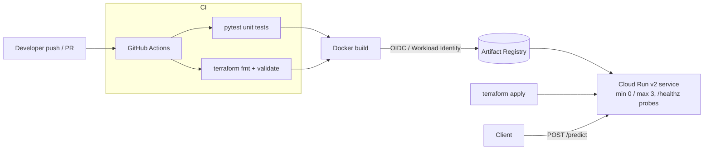

# ML Inference API on GCP: DevOps Mini Project

A small, production-style delivery pipeline around a machine-learning model. A FastAPI service serves a scikit-learn
Random Forest (Iris dataset, trained at startup). It's containerized with Docker, provisioned on **Google Cloud Run** with
**Terraform**, and shipped by a **GitHub Actions** CI/CD pipeline that uses keyless Workload Identity Federation auth.

> Status: built and tested locally as a portfolio demo. Not deployed to a live GCP project.

## Architecture


## Endpoints
| Method | Path | Description |
|---|---|---|
| GET | `/healthz` | Liveness/startup probe, returns version |
| POST | `/predict` | Body: `sepal_length, sepal_width, petal_length, petal_width` (all > 0) returns species + confidence |
| GET | `/docs` | OpenAPI UI |

## Run locally
```bash
python3 -m venv .venv && . .venv/bin/activate
pip install -r requirements-dev.txt
pytest -q
uvicorn app.main:app --port 8080
curl -X POST localhost:8080/predict -H 'content-type: application/json' \
  -d '{"sepal_length":6.7,"sepal_width":3.0,"petal_length":5.2,"petal_width":2.3}'
# Docker
docker build -t ml-inference-demo . && docker run -p 8080:8080 ml-inference-demo
```

## Deploy (optional, costs may apply)
```bash
cd terraform
terraform init
terraform apply -var project_id=YOUR_PROJECT -var image=us-central1-docker.pkg.dev/YOUR_PROJECT/ml-inference-demo/app:TAG
```
For CI deploys, set repo variable `GCP_PROJECT_ID` and secrets `GCP_WIF_PROVIDER` and `GCP_DEPLOY_SA`. The deploy job is skipped until they exist.
Use a GCS remote backend for Terraform state in real use.

## DevOps practices shown
- Infrastructure as Code (Terraform, Cloud Run v2, Artifact Registry, dedicated least-privilege service account, opt-in public access)
- CI gates: unit tests, `terraform fmt -check`, `terraform validate` before any build
- Keyless GitHub to GCP auth (OIDC/Workload Identity Federation), with no JSON keys
- Non-root container, health checks, scale-to-zero autoscaling, immutable SHA-tagged images
